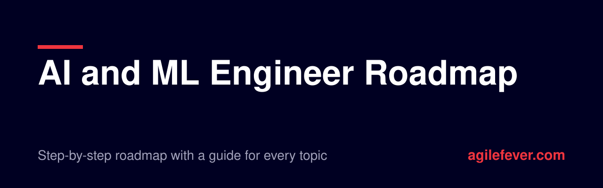

# AI and ML Engineer Roadmap

> A step-by-step roadmap to become an AI and ML Engineer, from Python and statistics to deep learning, computer vision and NLP, with a blog for every topic

## Table of Contents

- [Who is an AI and ML Engineer?](#who-is-an-ai-and-ml-engineer)
- [How to Use This Roadmap](#how-to-use-this-roadmap)
- [Step 0: Must Know](#step-0-must-know)
- [Step 1: Python for AI and ML](#step-1-python-for-ai-and-ml)
- [Step 2: Statistics and Probability](#step-2-statistics-and-probability)
- [Step 3: Data Handling, Visualization and Feature Engineering](#step-3-data-handling-visualization-and-feature-engineering)
- [Step 4: Supervised Learning: Regression](#step-4-supervised-learning-regression)
- [Step 5: Supervised Learning: Classification](#step-5-supervised-learning-classification)
- [Step 6: Model Evaluation, Tuning and Ensembles](#step-6-model-evaluation-tuning-and-ensembles)
- [Step 7: Unsupervised Learning](#step-7-unsupervised-learning)
- [Step 8: Deep Learning](#step-8-deep-learning)
- [Step 9: Computer Vision](#step-9-computer-vision)
- [Step 10: Sequence Models and NLP](#step-10-sequence-models-and-nlp)
- [Step 11: From Models to Applications](#step-11-from-models-to-applications)
- [Step 12: Projects, Portfolio and Career Preparation](#step-12-projects-portfolio-and-career-preparation)
- [Learn This Roadmap with a Mentor](#learn-this-roadmap-with-a-mentor)
- [License](#license)

### Prepared and maintained by [AgileFever](https://agilefever.com)

### Follow AgileFever

- [LinkedIn](https://www.linkedin.com/company/agilefever/)
- [YouTube](https://www.youtube.com/@AgileFever)
- [X/Twitter](https://x.com/agilefever)
- [Website](https://agilefever.com)

## Learn with AgileFever

- [AI and ML Engineer BootCamp](https://agilefever.com/bootcamps/ai-ml-engineer-bootcamp/)

---

> **Note: We keep updating this roadmap with new topics and blogs.**

---

### Who is an AI and ML Engineer?

An AI and ML Engineer builds systems that learn from data. They take raw data, prepare it, train and test models, and turn the result into something an application can use.

In simple words, this person is:

- **A data handler:** cleans data, explores it, and builds features a model can learn from.
- **A model builder:** trains regression, classification, clustering and neural network models, and picks the right one for the problem.
- **A practical engineer:** evaluates models honestly, tunes them, and builds working applications for images, text and predictions.

This is why the order matters. We start with Python and statistics, move to classical machine learning, then to deep learning, and finish with real projects.

### How to Use This Roadmap

This roadmap is designed so that you can follow it in the given order.

- Follow the steps in order. Each step builds on the previous one.
- Inside each step, read the blogs in the given order. Each blog covers one topic in plain words.
- A topic without a link is something to practise or look up in the official documentation of the tool.
- Do the projects at the end of each step on a dataset you choose. Reading alone is not enough for this role.
- After every step, ask yourself: "Can I explain this and use it on a small project?" If yes, move on.

Let's get started.

### Step 0: Must Know

Before the details, get the vocabulary right. These terms are used in every AI and ML conversation, and mixing them up is the most common beginner mistake.

- [Artificial Intelligence terms from A to Z](https://agilefever.com/artificial-intelligence-terms-ai-glossary-examples/)
- [What is Data Science?](https://agilefever.com/what-is-data-science-guide/)
- [Data Engineer vs Data Analyst vs Data Scientist](https://agilefever.com/data-engineer-vs-data-analyst-vs-data-scientist/)
- [Generative learning vs discriminative learning](https://agilefever.com/generative-learning-vs-discriminative-learning/)
- Types of analytics: descriptive, diagnostic, predictive, prescriptive

### Step 1: Python for AI and ML

Python is the working language of machine learning. In this step we learn enough Python to read data, write functions and run scripts without help.

- [Python for AI roadmap: NumPy, Pandas and PyTorch in the right order](https://agilefever.com/python-for-ai-roadmap/)
- [Python for AI: who should take the free course first](https://agilefever.com/python-for-ai-free-course-who-should-take-it/)
- [Python and math you need before an ML engineer bootcamp](https://agilefever.com/machine-learning-engineer-bootcamp-prerequisites/)
- Anaconda, Jupyter Notebooks and the command line
- Lists, tuples, dictionaries, sets, functions and exception handling
- Object-oriented programming, modules and packages

### Step 2: Statistics and Probability

Machine learning is statistics applied to data at scale. We need the basics to read a dataset and to know whether a result is real or luck.

- [Do you need calculus for linear algebra?](https://agilefever.com/do-you-need-calculus-for-linear-algebra/)
- Population vs sample, mean, median, mode, variance and standard deviation
- Distributions: uniform, binomial, Poisson and normal
- Central Limit Theorem
- Hypothesis testing, p-values, t-test and z-test
- ANOVA and the chi-square goodness of fit test
- Probability, conditional probability and Bayes' theorem

### Step 3: Data Handling, Visualization and Feature Engineering

Most of the work in a real project is data work. In this step we load data, look at it, and fix it before any model sees it.

- NumPy arrays and Pandas DataFrames
- Data visualization with Matplotlib and Seaborn
- Reading structured, unstructured and cloud data
- Exploratory data analysis: univariate, bivariate, multivariate
- Missing values and outlier treatment
- Handling imbalanced data
- Standardization and normalization
- [The data science life cycle](https://agilefever.com/what-is-data-science-guide/)

### Step 4: Supervised Learning: Regression

Supervised learning means learning from examples that already have the right answer. We start with regression, where the model predicts a number.

- [Machine Learning skills you will build with Scikit-learn](https://agilefever.com/machine-learning-skills-ai-ml-bootcamp/)
- [Machine learning courses: from Python to real-world projects](https://agilefever.com/machine-learning-courses/)
- Linear regression and multiple regression
- Assumptions of linear regression and how to read model output
- Project: predict sales revenue with a regression model

### Step 5: Supervised Learning: Classification

Classification predicts a category, such as spam or not spam. We learn the main algorithms and where each one works best.

- Logistic regression, the sigmoid function and odds ratio
- Decision trees: entropy, Gini index, pruning
- Naive Bayes and text classification
- Support Vector Machines and the kernel trick
- k-Nearest Neighbours
- Projects: click prediction, heart disease prediction, sentiment analysis

### Step 6: Model Evaluation, Tuning and Ensembles

A model is only useful if we can trust its score. This step covers how to measure a model, find overfitting, and improve results.

- Confusion matrix, precision, recall and the ROC curve
- Overfitting and the bias-variance trade-off
- Bagging, boosting and Random Forest
- Hyperparameter tuning with Grid Search CV
- Feature importance
- [Machine Learning and Deep Learning: from foundations to the future](https://agilefever.com/machine-learning-deep-learning-guide/)

### Step 7: Unsupervised Learning

Here the data has no right answer attached. The model finds structure on its own, such as groups of similar customers.

- Hierarchical clustering and dendrograms
- K-Means and choosing K with the elbow and silhouette methods
- Principal Component Analysis
- Eigenvalues and eigenvectors in plain words

### Step 8: Deep Learning

Deep learning uses neural networks with many layers. In this step we learn how a network learns, then build one with Keras and PyTorch.

- How a neuron works: activation functions and gradient descent
- Perceptron, multilayer networks and backpropagation
- Neural networks with TensorFlow and Keras
- [PyTorch in the right order](https://agilefever.com/python-for-ai-roadmap/)
- [CUDA in deep learning: how GPUs speed up training](https://agilefever.com/cuda-in-deep-learning/)
- [Machine Learning and Deep Learning: from foundations to the future](https://agilefever.com/machine-learning-deep-learning-guide/)

### Step 9: Computer Vision

Images are numbers arranged in a grid. We learn how a convolutional network reads them and build image classification and face detection projects.

- Image processing basics with OpenCV
- Convolutional Neural Networks: convolution, pooling and flattening
- Project: image classification with a CNN in Keras
- Project: face detection model

### Step 10: Sequence Models and NLP

Text and time series are sequences. We start with the older tools, RNN and LSTM, and the NLP basics, and then connect them to large language models.

- Recurrent Neural Networks and sequence prediction
- LSTM
- NLP basics: stop words, stemming, lemmatization, parts of speech
- TF-IDF, word embeddings and topic models
- Project: sentiment analysis and a simple chatbot
- [Large Language Models: a complete guide](https://agilefever.com/large-language-models-llm-guide/)

### Step 11: From Models to Applications

A model on a laptop is not a product. In this step we see how models become applications and what to watch for when you ship one.

- [Prompt engineering vs context engineering](https://agilefever.com/prompt-engineering-vs-context-engineering/)
- [Source code to build your first AI assistant with generative AI](https://agilefever.com/source-codes-build-ai-assistant-with-generative-ai/)
- [Building successful AI products with robust architecture](https://agilefever.com/building-successful-ai-products-with-robust-architecture/)
- [Build fast apps with AI: optimizing performance with machine learning](https://agilefever.com/build-fast-apps-with-ai/)
- [How to evaluate an LLM application](https://agilefever.com/evaluate-llm-application/)

### Step 12: Projects, Portfolio and Career Preparation

Hiring managers look for projects that show the full path from data to a working model. In this last step we plan the portfolio, choose a learning route and prepare for interviews.

- [What a capstone project should prove](https://agilefever.com/agilefever-capstones-what-they-prove/)
- [AI and ML BootCamp: the complete guide](https://agilefever.com/ai-ml-bootcamp-complete-guide/)
- [AI and ML BootCamp: module-by-module curriculum](https://agilefever.com/ai-ml-bootcamp-curriculum-breakdown/)
- [AI and ML BootCamp vs Gen AI BootCamp](https://agilefever.com/ai-and-ml-bootcamp-vs-gen-ai-bootcamp/)
- [AI and ML for career switchers with no coding background](https://agilefever.com/ai-ml-bootcamp-for-career-switchers/)
- [How a machine learning bootcamp can jump-start your career](https://agilefever.com/machine-learning-bootcamp-helps-career/)
- [AI learning plan for working professionals: 12 weeks](https://agilefever.com/ai-learning-plan-for-working-professionals/)
- Machine learning interview questions and answers

## Learn This Roadmap with a Mentor

If you prefer to learn this roadmap in a live cohort with labs and projects, the [AI and ML Engineer BootCamp](https://agilefever.com/bootcamps/ai-ml-engineer-bootcamp/) follows the same order. You can read the curriculum on the course page and decide whether it fits your background.

## License

This roadmap is licensed under CC BY 4.0. You may share and adapt it with credit to AgileFever.
